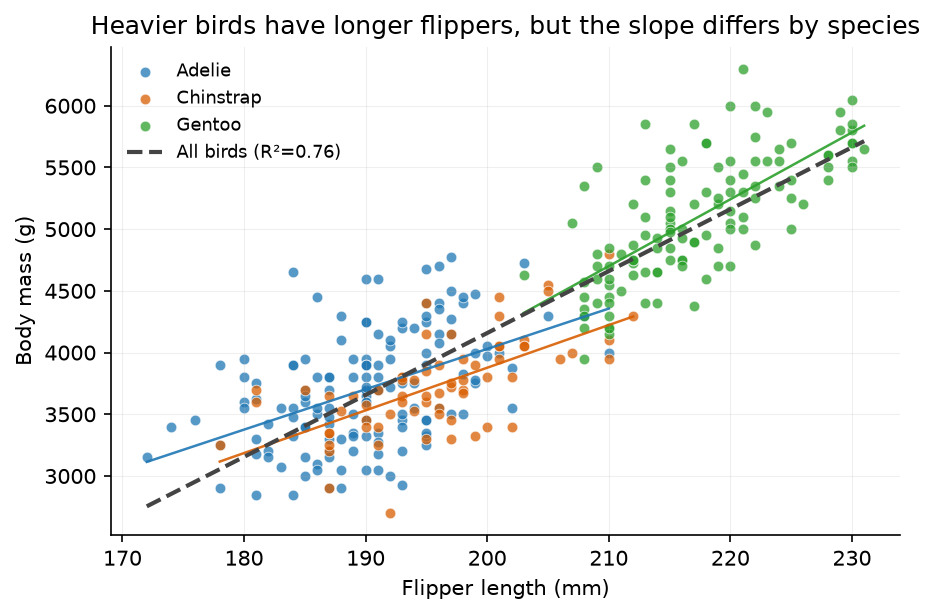
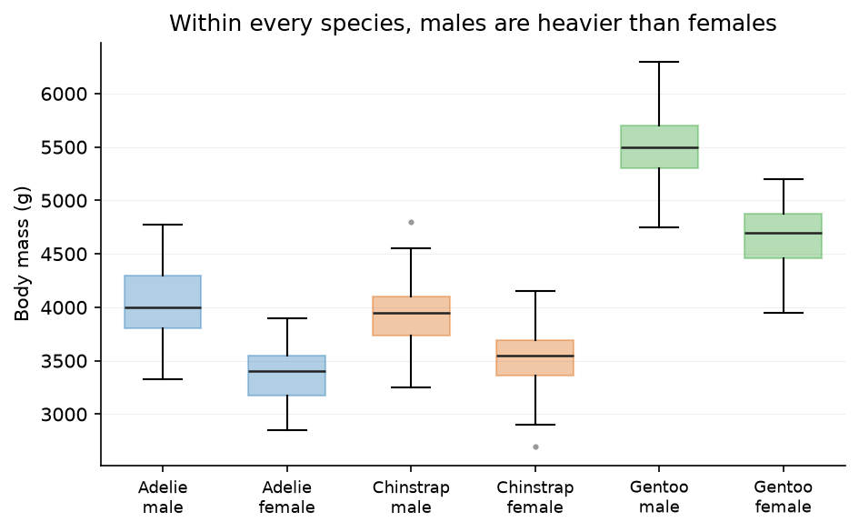

# JIANG JINGRU

Macao · Data Science and Data Visualization (CISC7204) · Student ID mc65169

I am an undergraduate student at the University of Macau working on data
science coursework and small exploratory-analysis projects. I enjoy turning
a messy question into a clean chart that a non-specialist can read in ten
seconds. Most of my work so far is in Python with pandas and matplotlib.

## Technical skills

- **Languages:** Python (pandas, NumPy, matplotlib), R (basic)
- **Data work:** exploratory data analysis, data cleaning, linear regression,
  descriptive statistics, visualization design
- **Tools:** Jupyter, Git & GitHub, GitHub Pages, UMMoodle-based coursework

## Project showcase

### Palmer Penguins: What Explains Body Mass Variation? — completed

**Research question.** How well do flipper length and sex explain body mass
across three Antarctic penguin species, and does the flipper–mass
relationship hold within each species?

**Findings.** Flipper length alone explains about **76%** of the variance in
body mass when all 333 birds are pooled — but the within-species slopes
differ sharply (Adelie ≈ 33 g/mm, R² = 0.22; Gentoo ≈ 54 g/mm, R² = 0.51),
because Gentoo penguins are both longest-flippered and heaviest. Sex matters
too: males average roughly 683 g heavier than females within every species.

**Limitation.** An observational sample of three species at three islands
(2007–2009) cannot be generalized to other populations or read causally.

- **Repository:** https://github.com/Jyrine/data-science-project
- **Status:** completed

---

*This site is built with GitHub Pages and deployed from the
`data-science-portfolio` repository.*
